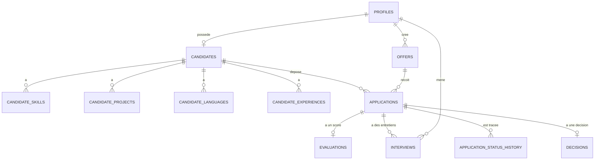

# QELLEBLI — *Connecting Young Talents to Opportunities.*

Application web de **suivi des candidatures (ATS)** pour les stages et premiers emplois : une entreprise centralise ses offres, évalue les candidats avec un score transparent, organise les entretiens, prend ses décisions et pilote son recrutement avec des indicateurs.

> Projet universitaire. Toutes les données de démonstration sont fictives.

---

## 1. Fonctionnalités par rôle

| Rôle | Ce qu'il peut faire |
|---|---|
| **Candidat** | Créer un compte · compléter son profil (formation, compétences, projets, langues, expériences, certifications) · téléverser son CV · consulter les offres et postuler à plusieurs · suivre le statut et l'historique de chaque candidature · voir la date de son entretien |
| **Responsable RH** | Créer, modifier, publier, clôturer et supprimer des offres · consulter, filtrer et trier les candidatures · voir profil, CV, score détaillé et conditions d'éligibilité · comparer 2 à 4 candidats · **pipeline visuel** : déplacer les cartes d'une étape à l'autre par glisser-déposer · programmer et évaluer les entretiens · changer les statuts · prendre la décision finale · tableau de bord RH |
| **Direction** | Tableau de bord global · indicateurs de performance · statistiques par offre, par mois et par score. **Aucun accès aux données personnelles des candidats** |

Un **sélecteur de comptes** (« Changer d'espace ») permet de passer du Candidat au RH ou à la Direction sans se déconnecter.

Des **suggestions de saisie** (villes, établissements, filières, services, compétences, langues) accélèrent le remplissage des profils et des offres ; les champs restent libres.

Le **score assiste** le recruteur ; il ne rejette **jamais** un candidat automatiquement. La **décision finale est humaine**.

## 2. Technologies

React 18 + TypeScript + Vite · Tailwind CSS · React Router · TanStack Query · Recharts · Supabase (PostgreSQL, authentification, stockage des CV). Tout fonctionne avec les offres gratuites.

## 3. Structure du projet

```
qellebli/
├── README.md
├── .env.example                  ← modèle de configuration
├── package.json · vite.config.ts · tailwind.config.js · tsconfig.json …
├── docs/
│   └── SCENARIO_DEMO.md          ← déroulé de présentation (10 min)
├── scripts/
│   └── create-demo-accounts.mjs  ← crée les 11 comptes de démonstration
├── supabase/migrations/          ← scripts SQL, à exécuter dans l'ordre
│   ├── 001_schema.sql            tables, relations, sécurité (RLS), stockage des CV
│   ├── 002_offers_visibility.sql le candidat garde accès aux offres où il a postulé
│   ├── 003_scoring.sql           moteur de score automatique
│   ├── 004_interviews_decisions.sql  entretiens et décisions finales
│   ├── 005_dashboard.sql         indicateurs RH
│   ├── 006_seed_demo.sql         données fictives de démonstration
│   ├── 007_remove_demo.sql       supprime la démonstration
│   ├── 008_oauth_signup.sql      nom repris du compte Google
│   └── 009_signup_allowlist_optional.sql  limiter les inscriptions à une liste (optionnel)
└── src/
    ├── main.tsx · App.tsx · index.css
    ├── context/AuthContext.tsx   connexion, session, rôle
    ├── hooks/                    accès aux données (profil, candidatures, indicateurs…)
    ├── lib/                      client Supabase, types, libellés
    ├── components/               mise en page, badges, graphiques, sections du profil
    └── pages/
        ├── Login · Register · NotFound · ConfigMissing
        ├── candidat/             tableau de bord, profil, offres, candidatures
        ├── rh/                   tableau de bord, offres, candidatures, fiche candidat,
        │                         comparaison, entretiens
        └── direction/            tableau de bord, statistiques
```

## 4. Base de données



| Table | Rôle |
|---|---|
| `profiles` | Comptes et rôles (`candidat`, `rh`, `direction`), liés à l'authentification |
| `candidates` (+ 4 tables de détail) | Fiche du candidat, compétences, projets, langues, expériences |
| `offers` | Offres de recrutement et conditions d'éligibilité |
| `applications` | Candidatures. **Unique par (candidat, offre)** : pas de doublon |
| `evaluations` | Scores par critère ; le score global est une **colonne calculée** (25/30/20/15/10) |
| `interviews` | Entretiens : date, recruteur, notes, résultat |
| `decisions` | Décision finale et justification **interne** |
| `application_status_history` | Historique horodaté de chaque changement de statut |

Règles garanties par la base : un candidat ne peut pas modifier ses statuts · une offre ne reçoit plus de candidatures après clôture ou date limite · une offre avec candidatures ne peut pas être supprimée (on la clôture) · tout nouveau compte est « candidat ».

## 5. Installation

**Prérequis** : [Node.js](https://nodejs.org) 20.6 ou plus (version LTS) · [VS Code](https://code.visualstudio.com) · un compte gratuit [Supabase](https://supabase.com).

1. **Projet Supabase** : créez un projet gratuit.
2. **Base de données** : dans Supabase → *SQL Editor*, exécutez dans l'ordre, un par un, le contenu de `001` à `005` (copier-coller puis *Run*). L'avertissement « destructive » du script `004` est normal.
3. **Authentification** : *Authentication → Sign In / Providers → Email* : activez *Allow new users to sign up* et **désactivez *Confirm email*** (développement), puis *Save*.
4. **Configuration** : copiez `.env.example` en `.env`, puis renseignez :
   - `VITE_SUPABASE_URL` : l'URL du projet, du type `https://xxxx.supabase.co` (sans `/rest/v1/`) ;
   - `VITE_SUPABASE_ANON_KEY` : la clé **publishable** (jamais la clé *secret*).
5. **Dépendances** : dans le terminal VS Code, ouvert dans le dossier du projet : `npm install`.
6. **Lancement** : `npm run dev`, puis ouvrez <http://localhost:5173>.

Sous Windows, si PowerShell refuse `npm`, exécutez une fois :
`Set-ExecutionPolicy -Scope CurrentUser -ExecutionPolicy RemoteSigned`.

## 6. Comptes et données de démonstration

1. Créer les comptes : `node --env-file=.env scripts/create-demo-accounts.mjs`
2. Dans Supabase → *SQL Editor* : exécuter `006_seed_demo.sql`. Il peut être relancé à volonté.

**Mot de passe de tous les comptes : `Demo2026!Qellebli`**

| Rôle | Email |
|---|---|
| Direction | `direction@example.com` |
| Responsable RH | `rh@example.com` (et `rh2@example.com`) |
| Candidat (principal) | `candidat@example.com` |
| Autres candidats | `omar.elidrissi@`, `salma.tazi@`, `mehdi.alaoui@`, `imane.chraibi@`, `anas.berrada@`, `hajar.lahlou@`, `youssef.naciri@` + `example.com` |

Contenu : 5 offres, 16 candidatures à tous les stades (reçue → acceptée/refusée), scores calculés, 6 entretiens, 9 décisions, historique daté sur 6 mois. Pour tout supprimer : `007_remove_demo.sql`.

Les candidats fictifs n'ont pas de fichier CV : pour montrer le dépôt de CV, connectez-vous en `candidat@example.com`, téléversez un PDF dans *Mon profil*, puis postulez à l'offre « Assistant Ressources Humaines ».

Le déroulé complet d'une présentation est dans [`docs/SCENARIO_DEMO.md`](docs/SCENARIO_DEMO.md).

## 7. Score automatique (transparent)

Chaque critère est noté sur 100. Le score est calculé à chaque dépôt de candidature ; le RH peut cliquer sur *Recalculer* après une mise à jour du profil.

| Critère | Poids | Règle |
|---|---|---|
| Formation | 25 % | Niveau d'études comparé au minimum de l'offre (70 %) + filière (30 %) |
| Compétences techniques | 30 % | Couverture des compétences requises (70 %) + niveau moyen (30 %) |
| Projets | 20 % | Nombre de projets (70 %) + lien avec les compétences requises (30 %) |
| Langues | 15 % | Niveau sur les langues requises de l'offre |
| Expériences complémentaires | 10 % | Nombre d'expériences et de certifications |

La fiche candidat affiche le score global, le score par critère, une explication, les points forts et les points à améliorer.

## 8. Indicateurs RH

Calculés par la base à partir des données réelles (fonction `get_hr_dashboard`).

| Indicateur | Définition |
|---|---|
| Candidatures en cours | Ni acceptées ni refusées |
| Présélectionnés | Passés au moins une fois par « Présélectionnée », « Entretien programmé » ou « Acceptée » |
| Taux de présélection | Présélectionnés ÷ candidatures |
| Conversion entretien → recrutement | Acceptés ayant eu un entretien ÷ candidats ayant eu un entretien |
| Durée moyenne du processus | Jours entre le dépôt et la décision finale |
| Délai de traitement initial | Temps entre le dépôt et la première action du recruteur |

## 9. Sécurité

- Authentification Supabase ; mots de passe jamais stockés en clair.
- Routes protégées par rôle côté application **et** règles d'accès (RLS) côté base de données.
- Un candidat ne voit que ses données ; il ne voit ni scores, ni notes d'entretien, ni justifications.
- La Direction n'accède à aucune donnée personnelle de candidat.
- CV dans un espace privé, un dossier par utilisateur, liens temporaires de 60 secondes.
- Les fonctions de score et d'indicateurs refusent les rôles non autorisés.

Ces règles ont été vérifiées sur une base PostgreSQL de test (candidat, RH, Direction).

## 10. Correspondance avec le cahier des charges

| Objectif | Réalisation |
|---|---|
| Centraliser 100 % des candidatures | Toutes les candidatures sont dans la table `applications`, consultables par les RH |
| Simplifier la gestion des offres | Création, publication, clôture, suppression contrôlée |
| Réduire de 30 % le temps de traitement initial | L'indicateur *Délai de traitement initial* le **mesure** ; la réduction se démontre en comparant avec un traitement manuel dans un scénario de test |
| Faciliter l'évaluation et la comparaison | Fiche détaillée, filtres, comparaison côte à côte sans « gagnant » |
| Automatiser le calcul des scores | Calcul automatique au dépôt, par la base |
| Assurer la traçabilité | Historique de statuts horodaté, décisions et entretiens enregistrés |
| Fournir des indicateurs de pilotage | Tableaux de bord RH et Direction avec graphiques |

## 11. Limites connues

- Dans le profil, une compétence, un projet, une langue ou une expérience s'ajoute et se supprime, mais ne se modifie pas sur place.
- Le glisser-déposer du pipeline ne fonctionne pas au toucher : sur téléphone, utiliser le menu « Déplacer… » de chaque carte.
- Pas de notifications par email.
- Le score compare des **textes** (« Excel » avec « excel ») : il faut des intitulés cohérents entre les offres et les profils. Les suggestions de saisie aident à rester cohérent, mais ne sont pas obligatoires.
- Les RH partagent les mêmes données : pas de cloisonnement par recruteur.
- Tests automatisés (`npm test`, 35 tests) : ils couvrent le pipeline, la saisie par étiquettes et le changement de compte (jetons renouvelés, session expirée, vidage du cache). La logique SQL (score, indicateurs, sécurité par rôle) a été vérifiée sur une base PostgreSQL locale, sans scripts de test livrés.
- Le sélecteur de comptes mémorise des jetons de session dans le navigateur : à réserver à un appareil personnel.
- Pour une mise en production : réactiver *Confirm email* avec un service d'envoi d'emails, supprimer la démonstration (`007`), et héberger le front (Vercel ou Netlify, offres gratuites).

## 12. Partager l'application en ligne (prof et équipe)

L'application est un site statique : après `npm run build`, le dossier `dist` se publie gratuitement (par exemple sur Netlify, par glisser-déposer). Le fichier `public/_redirects` est inclus dans `dist` et permet de recharger une page comme `/rh` sans erreur 404.

Pour limiter l'usage aux personnes voulues : désactiver *Allow new users to sign up* dans Supabase (seuls les comptes existants peuvent se connecter), ne partager le lien et les identifiants qu'avec l'équipe et l'enseignant. La protection du site entier par mot de passe est une option payante chez Netlify.

Un projet Supabase gratuit se met en pause après 7 jours de faible activité : le réactiver avec *Resume project*.

## 13. Connexion avec Google (optionnel)

Le bouton *Continuer avec Google* est présent sur les pages de connexion et d'inscription. Il demande une configuration unique :

1. **Google Cloud** (console.cloud.google.com) : créer un projet ; dans *Google Auth Platform*, renseigner le nom de l'application, l'e-mail d'assistance et choisir l'audience *External* ; dans *Clients*, créer un client de type *Web application* avec, en *Authorized JavaScript origins*, `http://localhost:5173` et l'adresse du site en ligne, et en *Authorized redirect URIs* l'adresse de rappel fournie par Supabase (`https://xxxx.supabase.co/auth/v1/callback`). Copier le *Client ID* et le *Client secret*.
2. **Supabase** : *Authentication > Sign In / Providers > Google* : activer, coller le Client ID et le Client secret, enregistrer. Dans *URL Configuration*, définir le *Site URL* et ajouter `http://localhost:5173/**` et `https://votre-site.netlify.app/**` aux *Redirect URLs*.
3. **Base de données** : exécuter `008_oauth_signup.sql` (reprend le nom du compte Google).
4. Garder *Allow new users to sign up* activé : sinon aucun nouveau compte ne peut être créé.

Toute personne qui s'inscrit (Google ou e-mail) devient **candidat**. Les rôles RH et Direction ne s'attribuent que depuis Supabase.

Pour réserver les inscriptions à une liste (enseignant, équipe), exécuter `009_signup_allowlist_optional.sql` puis ajouter les adresses dans la table `allowed_signups` (exemple dans le fichier). Table vide : inscriptions ouvertes à tous.

Le secret du client Google ne se met jamais dans `.env` ni dans le code : uniquement dans Supabase.

## 14. Changer d'espace sans se déconnecter

Le bouton **Changer d'espace** (menu latéral) liste les comptes mémorisés sur l'appareil : un clic bascule de l'un à l'autre, sans mot de passe. Pour mémoriser un compte : **Changer d'espace → Ajouter un compte**, puis se connecter avec cet autre compte ; le précédent reste disponible. Une fois les trois comptes de démonstration ajoutés, la bascule entre Candidat, RH et Direction est instantanée.

- Chaque compte garde ses droits : un compte n'a jamais qu'un seul rôle, attribué dans Supabase. On change de **compte**, pas de rôle.
- Le cache des données est vidé à chaque changement de compte : aucune donnée d'un espace ne reste affichable dans un autre.
- *Déconnexion* se déconnecte du compte actif et l'oublie ; la croix à côté d'un compte l'oublie sur cet appareil.
- Sur la page de connexion, les comptes mémorisés se reprennent en un clic. Si la session d'un compte a expiré, il est retiré et il faut le rajouter.
- **Sécurité** : les jetons de session de chaque compte mémorisé sont conservés dans le navigateur (comme l'est déjà celui du compte actif). À utiliser uniquement sur son propre appareil, jamais sur un ordinateur partagé.

## 15. Dépannage

| Symptôme | Solution |
|---|---|
| `npm` n'est pas reconnu | Installer Node.js, puis fermer et rouvrir VS Code |
| « running scripts is disabled » | Commande `Set-ExecutionPolicy` de la section 5 |
| `ENOENT … package.json` | Le terminal n'est pas dans le dossier du projet (`cd qellebli`) |
| Page « Configuration Supabase manquante » | `.env` absent, mal placé ou non enregistré ; relancer `npm run dev` |
| Connexion impossible après modification du `.env` | Arrêter (Ctrl+C) puis relancer `npm run dev` |
| « Email signups are disabled » | Activer *Allow new users to sign up* (étape 3) |
| `ERR_CONNECTION_REFUSED` | Le serveur est arrêté : relancer `npm run dev` |
| Page en anglais avec des mots étranges | Le navigateur traduit la page : choisir *Afficher l'original* |
| Indicateurs introuvables | Exécuter `005_dashboard.sql` |
| Google : « redirect_uri_mismatch » | L'adresse de rappel dans Google Cloud doit être identique à celle affichée dans Supabase (Providers > Google) |
| Google : « La connexion Google n'est pas encore activée » | Activer le fournisseur Google dans Supabase et enregistrer le Client ID et le Client secret |
| Retour de Google sur une page d'erreur | Ajouter l'adresse du site dans *Redirect URLs* de Supabase |
